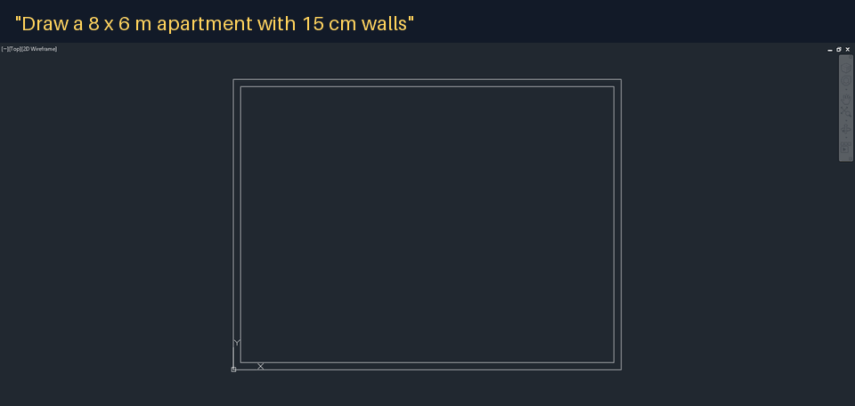

# acad-mcp — let Claude drive AutoCAD

<!-- mcp-name: io.github.thurdevv/acad-mcp -->

**[Português](README.pt-BR.md)**

An [MCP](https://modelcontextprotocol.io) server that lets Claude (and other MCP clients) **draw, edit, read and
check drawings in the AutoCAD running on your Windows PC** — and process whole folders of DWGs without opening them.



- **61 tools + a guided prompt**, every write is **one undo step** (Ctrl+Z).
- **Fast on large drawings**: reads run as LISP inside AutoCAD — 50,000 entities in ~15 s (vs ~22 min over COM).
- **Batch**: run a routine or a layer standard over a folder with AutoCAD's console engine (no window, in
  parallel). **Originals are never modified** — copies go to an output folder.
- **Routines without AI**: built-in LISP routines (find/replace, fill title blocks, export attributes, count
  blocks, layer standard from CSV, purge/audit, plot PDF) that a person can also type as `MCP_...` commands.
- **Recreate drawings**: import vector PDFs with real measurements, DXF/DWG, or trace scans/photos into lines;
  a coordinate grid on screenshots lets the model compare and fix.
- **English and Portuguese** (`ACAD_MCP_LANG=pt`).

> AutoCAD is a registered trademark of Autodesk, Inc. This project is not affiliated with or endorsed by Autodesk.

## Requirements

- **Windows** and the **full AutoCAD** (uses COM/ActiveX). **AutoCAD LT is not supported** (no COM, no console).
  Tested on **AutoCAD 2027**; earlier versions (2021+) are likely to work but are not verified.
- [uv](https://docs.astral.sh/uv/) (it installs Python 3.13 for you).
- Linux/macOS: not possible — AutoCAD's automation only exists on Windows.

## Install

### Claude Desktop — extension (easiest)
Download `acad-mcp-<version>.mcpb` from the Releases page and open it with Claude Desktop
(Settings → Extensions). Options: language, read-only, LISP on/off, auto-restore window.

### With pip
```bash
pip install acad-mcp
acad-mcp install-claude
```
`pip install` only installs the program (needs Python 3.13+). The second command — or simply double-clicking
`acad-mcp.exe` in your Python `Scripts` folder — connects it to Claude Desktop: it asks the language, closes Claude
(after asking), writes the config with a backup and reopens Claude. To disconnect: `acad-mcp uninstall-claude`.

### Claude Desktop — config file
```json
{
  "mcpServers": {
    "acad": { "command": "uvx", "args": ["acad-mcp"], "env": { "ACAD_MCP_LANG": "en" } }
  }
}
```
Edit the config **with Claude fully closed** (tray icon → Quit): Claude rewrites the file from memory when it
quits, which would drop your change.

### One-click install from this folder (Windows)
Double-click **`INSTALAR.bat`**: it checks AutoCAD, asks the language, closes Claude (after asking), installs uv
if missing, installs Python and the dependencies, configures Claude (with a backup), runs a self-test and reopens
Claude. A `.venv` copied from another PC is detected and rebuilt.

### Claude Code
```bash
claude mcp add --scope user acad -- uvx acad-mcp
```

### Other MCP clients
Any client that runs local stdio servers: command `uvx`, args `["acad-mcp"]`. For HTTP: `acad-mcp --http`
(listens on 127.0.0.1:8765/mcp only).

## Use

Open AutoCAD and keep its window **not minimized** (it may stay behind other windows). Then ask, e.g.:

- *"Create layers WALL (red, 0.35) and AXIS (green, CENTER) and draw a 4 × 3 m room with axes and dimensions."*
- *"Count the blocks and export their attributes to a CSV on my Desktop."*
- *"Check this drawing against the `example` standard and fix what you can."*
- *"In C:\Projects\Sheets, replace 'REV A' with 'REV B' in every drawing."* (batch, originals untouched)
- *"Recreate the attached part directly in AutoCAD with dimensions, then show me."*

## Tools

| Group | Tools |
|---|---|
| Document | `status`, `list_documents`, `new_drawing`, `open_drawing`, `activate_drawing`, `save_drawing`, `close_drawing` |
| Read | `drawing_info`, `list_layers`, `list_styles`, `list_blocks`, `query_entities`, `get_entity`, `get_selection` |
| View | `get_view_image` (screenshot, optional coordinate grid), `zoom_view` |
| Draw | `draw_line`, `draw_polyline`, `draw_rectangle`, `draw_circle`, `draw_arc`, `draw_text`, `draw_dimension`, `draw_hatch`, `draw_leader`, `draw_table`, `insert_block`, `create_block`, `draw_batch` |
| Edit | `transform_entities`, `array_entities`, `offset_entity`, `erase_entities`, `set_entity_properties`, `edit_text`, `set_block_attributes`, `modify_geometry`, `explode_entities` |
| Layers & styles | `manage_layer`, `manage_text_style`, `set_current`, `load_linetype` |
| Data | `quantities`, `block_report` (CSV) |
| Standards | `list_standards`, `check_standards`, `apply_standards`, `purge_and_audit` |
| Files & recreate | `import_file` (DXF, DWG, vector PDF, image), `list_received_files`, `trace_image` |
| Routines & batch | `list_routines`, `run_routine`, `save_routine`, `export_routines_for_autocad`, `batch_process`, `batch_status` |
| Escape hatches | `run_command`, `run_lisp`, `undo`, `cancel_command` |

Prompt: `recreate_drawing` — measurements first, ask for what is missing, draw, compare, fix.

## Configuration

| Variable | Default | Meaning |
|---|---|---|
| `ACAD_MCP_LANG` | `en` | `pt` for Portuguese descriptions and messages |
| `ACAD_MCP_READ_ONLY` | `0` | `1` = only reading tools are registered |
| `ACAD_MCP_ALLOW_LISP` | `1` | `0` disables `run_lisp`, routines and batch routines |
| `ACAD_MCP_ALLOW_COMMANDS` | `1` | `0` disables `run_command` |
| `ACAD_MCP_AUTO_RESTORE` | `0` | `1` restores a minimized AutoCAD when needed (AutoCAD may grab focus) |
| `ACAD_MCP_COMMAND_TIMEOUT` | `30` | seconds before a command waiting for input is cancelled |
| `ACAD_MCP_FAST_THRESHOLD` | `300` | entity count above which reads use in-process LISP |
| `ACAD_MCP_STANDARDS_DIR` | `Documents\AutoCAD MCP\standards` | your JSON standards |
| `ACAD_MCP_ROUTINES_DIR` | `Documents\AutoCAD MCP\routines` | your saved routines |

## How it works (and what was measured)

- One COM thread talks to AutoCAD; a **COM message filter** retries calls while AutoCAD is busy, so a tool is
  never re-run (re-running duplicated saves during development).
- Commands/LISP go through `SendCommand` with a **watchdog**: if a command waits for input, ESC is sent to the
  drawing area (ESC to the main window does not cancel). The command line rejects expressions over ~1–2 k
  characters, so long LISP is written to a temp file and read+evaluated (reading text does not trigger
  SECURELOAD, unlike `(load)`).
- With the window **minimized**, `SendCommand` gets queued and AutoCAD freezes when restored, so commands, LISP and
  screenshots refuse to run minimized (unless auto-restore is on). Direct drawing/editing works minimized.
- COM selection sets leave internal "OLEAPPLICATION" undo records; `undo` skips them.
- **Batch console engine** (`accoreconsole.exe`): pure AutoLISP and `vlax-curve-*` work, **`vla-*` does not**;
  plotting to PDF and saving work. Measured: 3 files in ~1.5 s with 3 workers. Use `engine="gui"` for
  `vla-*` routines and JSON standards.
- **PDF import**: `-PDFIMPORT` runs without a dialog. PDFs plotted by AutoCAD came back at real size; PDFs
  without CAD scale come in inches (1 pt = 1/72") — rescale and check one known measurement.
- **trace_image** is a draft: straight strokes within ~1 % on clean drawings in tests; curves and text are not
  traced.

## Safety

- Never writes over an existing file without `overwrite=true`; closing with unsaved changes needs
  `discard_changes=true`; batch only touches copies.
- `run_command` blocks SHELL, START, NETLOAD, APPLOAD, SCRIPT, QUIT and similar; file dialogs are off.
- `run_lisp` blocks `startapp`, file deletion/renaming, registry writes, etc. **It is not a sandbox** — LISP can
  do a lot. Disable it with `ACAD_MCP_ALLOW_LISP=0` or use read-only mode.
- HTTP mode listens on localhost only. **Never expose it publicly without authentication**: whoever reaches it
  controls your AutoCAD. See [SECURITY.md](SECURITY.md).

## ChatGPT

ChatGPT only talks to remote MCP servers. See [docs/chatgpt.md](docs/chatgpt.md) (OpenAI Secure MCP Tunnel; not
fully verified yet).

## Development

```bash
uv sync
uv run pytest -m "not live"     # no AutoCAD needed
uv run pytest                   # also the live tests: AutoCAD open, window not minimized
uv build                        # wheel + sdist
uv run python scripts/build_mcpb.py   # Claude Desktop extension (needs Node.js)
```
The live tests create their own drawings and close them without saving; they never touch yours.

## License

MIT — see [LICENSE](LICENSE).
