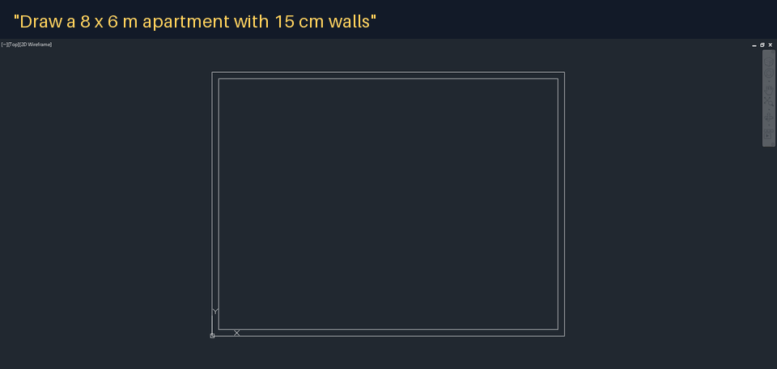

# acad-mcp — o Claude mexendo no AutoCAD

**[English](README.md)**

Um servidor [MCP](https://modelcontextprotocol.io) que deixa o Claude (e outros clientes MCP) **desenhar, editar,
ler e conferir desenhos no AutoCAD aberto no seu PC Windows** — e processar pastas inteiras de DWGs sem abri-los.



- **61 ferramentas + um roteiro guiado**; cada alteração é **um Ctrl+Z**.
- **Rápido em desenho grande**: a leitura roda como LISP dentro do AutoCAD — 50 mil entidades em ~15 s (contra
  ~22 min via COM).
- **Lote**: roda uma rotina ou um padrão de layers numa pasta inteira pelo AutoCAD sem janela (accoreconsole), em
  paralelo. **Os originais nunca são alterados** — as cópias vão para uma pasta de saída.
- **Rotinas sem IA**: rotinas LISP prontas (localizar/substituir, preencher carimbo, exportar atributos, contar
  blocos, padrão de layers por CSV, purge/audit, plotar PDF) que a pessoa também pode digitar como comandos `MCP_...`.
- **Recriar desenhos**: importa PDF vetorial com as medidas reais, DXF/DWG, ou rastreia scans/fotos em linhas;
  a grade de coordenadas na foto da tela deixa o modelo comparar e corrigir.
- **Português e inglês** (`ACAD_MCP_LANG=pt`).

> AutoCAD é marca registrada da Autodesk, Inc. Este projeto não tem vínculo com a Autodesk nem é endossado por ela.

## Requisitos

- **Windows** e **AutoCAD completo** (usa COM/ActiveX). **AutoCAD LT não funciona** (não tem COM nem console).
  Testado no **AutoCAD 2027**; versões a partir de 2021 provavelmente funcionam, mas não foram verificadas.
- **Python 3.10 ou mais novo** para instalar pelo pip (testado do 3.10 ao 3.14). A extensão, o `uvx` e o
  `INSTALAR.bat` trazem o próprio Python pelo [uv](https://docs.astral.sh/uv/) e não precisam de nenhum instalado.
- Linux/macOS: não é possível — a automação do AutoCAD só existe no Windows.

## Instalação

### Claude Desktop — extensão (mais fácil)
Baixe `acad-mcp-<versão>.mcpb` na página de Releases e abra com o Claude Desktop (Configurações → Extensões).
Opções: idioma (escolha `pt`), somente leitura, LISP ligado/desligado, restaurar janela.

### Com o pip
```bash
py -m pip install acad-mcp
py -m acad_mcp install-claude
```
Precisa de **Python 3.10 ou mais novo**. O primeiro comando só instala o programa; o segundo conecta ao Claude
Desktop: pergunta o idioma, fecha o Claude (pedindo confirmação), grava a configuração com backup e reabre o
Claude. Para desconectar: `py -m acad_mcp uninstall-claude`.

Por que `py -m ...`: ele usa sempre o mesmo Python nos dois passos e funciona mesmo quando a pasta `Scripts` do
Python não está no PATH (nesse caso, o `acad-mcp install-claude` puro falha com "não é reconhecido"). Sem o
atalho `py`, use `python -m pip install acad-mcp` e `python -m acad_mcp install-claude`. Dar dois cliques no
`acad-mcp.exe`, na pasta `Scripts` do seu Python, abre o mesmo assistente.

### Claude Desktop — arquivo de configuração
```json
{
  "mcpServers": {
    "acad": { "command": "uvx", "args": ["acad-mcp"], "env": { "ACAD_MCP_LANG": "pt" } }
  }
}
```
Edite **com o Claude totalmente fechado** (ícone perto do relógio → Sair): ao sair, o Claude regrava o arquivo com
o que tem na memória e apagaria a sua alteração.

### Instalação com um clique a partir desta pasta (Windows)
Dê dois cliques em **`INSTALAR.bat`**: ele confere o AutoCAD, pergunta o idioma, fecha o Claude (pedindo
confirmação), instala o uv se faltar, instala o Python e as dependências, configura o Claude (com backup), faz um
autoteste e reabre o Claude. Um `.venv` copiado de outro PC é detectado e refeito.

### Claude Code
```bash
claude mcp add --scope user acad -e ACAD_MCP_LANG=pt -- uvx acad-mcp
```

## Uso

Abra o AutoCAD e deixe a janela **não minimizada** (pode ficar atrás de outras). Peça, por exemplo:

- *"Crie os layers PAREDE (vermelho, 0,35) e EIXO (verde, CENTER) e desenhe uma sala de 4 × 3 m com eixos e cotas."*
- *"Conte os blocos e exporte os atributos para um CSV na Área de Trabalho."*
- *"Confira este desenho contra o padrão `example` e corrija o que der."*
- *"Na pasta C:\Projetos\Folhas, troque 'REV A' por 'REV B' em todos os desenhos."* (lote, originais intactos)
- *"Recrie a peça da imagem anexada direto no AutoCAD, com cotas, e me mostre."*

A lista completa de ferramentas, configurações e detalhes técnicos está no [README em inglês](README.md).

## Segurança

- Nunca grava por cima de arquivo existente sem `overwrite=true`; fechar com alterações exige
  `discard_changes=true`; o lote só mexe em cópias.
- `run_command` bloqueia SHELL, START, NETLOAD, APPLOAD, SCRIPT, QUIT etc.
- `run_lisp` bloqueia `startapp`, apagar/renomear arquivos, registro do Windows etc. **Não é uma caixa de areia**.
  Desligue com `ACAD_MCP_ALLOW_LISP=0` ou use o modo somente leitura.
- O modo HTTP só escuta em localhost. **Nunca exponha publicamente sem autenticação.** Veja [SECURITY.md](SECURITY.md).

## Licença

MIT — veja [LICENSE](LICENSE).
